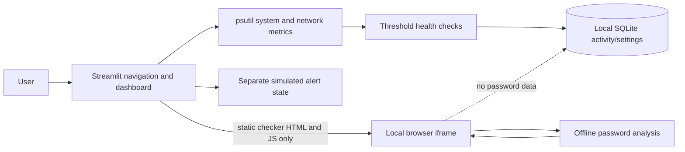

# Snakbite — Basic Cybersecurity Monitor

**Monitor. Detect. Protect.** A local educational monitoring dashboard for a B.Tech CSE project.

Snakbite reads actual resource and network-counter metrics from the computer where it runs. A configurable rule-based check reports CPU, RAM, and disk resource health. Findings and important actions are saved locally in SQLite. The app includes a visibly fictional demo alert and a browser-only password checker.

> A resource warning is not proof of an attack. The demo alert is simulated and is not evidence of a real incident. Snakbite is not antivirus software or professional security monitoring.

## Project contents

```text
Snakbite/
  app.py
  requirements.txt
  run_snakbite.bat
  .gitignore
  .streamlit/config.toml
  modules/
    system_monitor.py   # Read-only psutil metric and process collection
    security_checks.py  # Configurable CPU/RAM/disk rules
    storage.py          # SQLite activity, settings, demo status
    charts.py           # Plotly metric history chart
    password_security.py # Local browser component host; no password handling in Python
    password_analyzer.js # Offline client-side password analysis and UI logic
  data/                 # Created on first launch; local SQLite database
```

## Architecture



Password analysis runs in the browser iframe using locally served JavaScript. Only the static checker source is sent by the local app; the typed password and optional comparison value remain in the iframe and are not submitted back to Python.

## Install Python on Windows

1. Download Python 3.10 or newer from [python.org/downloads](https://www.python.org/downloads/).
2. During setup, select **Add python.exe to PATH**, then finish installation.
3. Download and extract the Snakbite ZIP to a writable folder (for example, Documents).
4. Open the extracted `Snakbite` folder in File Explorer. Click the address bar, type `cmd`, and press Enter to open Command Prompt there.

## Launch

Double-click `run_snakbite.bat`. On the first run it creates `.venv`, installs dependencies, and starts Streamlit. Keep the terminal open and visit the local URL it prints, usually [http://localhost:8501](http://localhost:8501).

Or run the commands manually from Command Prompt in the project folder:

```bat
python -m venv .venv
.venv\Scripts\activate
python -m pip install --upgrade pip
pip install -r requirements.txt
streamlit run app.py
```

Press **Ctrl+C** in the terminal to stop the app.

## Deploy on Streamlit Community Cloud

Community Cloud deploys an app from a GitHub repository and reads the entrypoint and `requirements.txt` from the repository. The project is laid out with `app.py` at the root for that workflow. See the [official deploy guide](https://docs.streamlit.io/deploy/streamlit-community-cloud/deploy-your-app/deploy) and [dependency guide](https://docs.streamlit.io/deploy/streamlit-community-cloud/deploy-your-app/app-dependencies).

1. Put this project in a GitHub repository that you administer. Keep the repository **private** unless you explicitly want the source code public.
2. Sign in to Streamlit Community Cloud and connect GitHub access to that repository.
3. Choose **Create app**, select the repository and branch, and set the main file path to `app.py`.
4. Keep the deployed app private unless you choose to share it. The app and repository access settings are separate; review Streamlit's sharing settings before distributing its URL.

**Hosted behavior:** system metrics describe the Linux cloud container running Snakbite, not a visitor's personal computer. Streamlit Community Cloud does not guarantee persistence for files generated while the app runs, so the SQLite log, settings, and demo state can be lost between sessions or after a restart. This hosted version is best for a short demonstration; use the local Windows launcher when reliable persistent local logs matter. Community Cloud may also put inactive apps to sleep.

The password checker remains in a browser-side component and makes no external lookups. As with any online app, only use it on a computer and app deployment that you trust.

## Using the app

- **Dashboard:** live system metrics, health overview, collected metric history, recent local events, and quick actions.
- **System Monitor:** operating system, device, uptime, memory, and read-only process list.
- **Network Monitor:** interface/IP metadata, system byte counters, and visible connection metadata where permissions allow. Unknown addresses are not labelled malicious.
- **Security Alerts:** separate simulated alert with details, resolve/reopen, and reset actions; real health-check findings are shown in a separate section.
- **Password Security:** live browser-only strength estimate, quality checklist, local common/pattern detection, weakness details, recommendations, and reset. The input is masked by default, with a show/hide toggle. No password or reversible representation is logged or persisted.
- **Activity Logs:** newest-first persistent events, severity/source filters, search, CSV export, and confirmation before clearing.
- **Settings:** warning/critical thresholds and a saved preferred refresh interval. Refresh is user-triggered.
- **About:** workflow, limitations, future scope, beginner introduction, demo script, and viva questions.

Default thresholds are 80% warning and 90% critical. A result above a threshold is only a resource-use observation. Metric chart points exist only after the user refreshes; this history is held in memory and resets on app restart.

## Local data and privacy

The SQLite file is created at `data/snakbite.db` on first run. It stores activity events, user threshold settings, and demo-alert status/history. In a local run this stays on your device. No monitoring data is uploaded. The application does not collect credentials, inspect packets, stop processes, or scan networks. Delete the database only while the app is stopped if you want to reset all local data. On Community Cloud, generated files are not guaranteed to persist.

The Password Security page runs its analyzer entirely in a local browser component. Password and optional comparison text are not sent to Python, Streamlit session state, external APIs, analytics, logs, SQLite, CSV, or browser storage. Reset clears both fields. Only enter a password if you trust the computer and the app source. The limited common-password examples are not a leaked-password database and do not represent an internet-wide lookup.

The score combines length, character groups and uniqueness with deductions for listed predictable patterns. A long, unique passphrase can score well without symbol substitutions. The optional entropy figure assumes a uniformly random password drawn from the observed character groups; it is a theoretical upper bound, not an estimated crack time or a guarantee. Real attack effort depends on how the password was chosen, leaked information, hashing, and attacker strategy.

## Troubleshooting

- **`python` is not recognized:** rerun the Python installer and enable **Add Python to PATH**; reopen Command Prompt. The launcher also tries the Windows `py -3` command.
- **Missing packages / install error:** ensure internet access for the initial pip download, then activate `.venv` and run `pip install -r requirements.txt` again.
- **Port 8501 is busy:** start with `streamlit run app.py --server.port 8502` and use the URL printed in the terminal.
- **Metric says Unavailable / connection list is empty:** some values depend on OS support and permissions. Snakbite handles unavailable values gracefully; do not run with elevated privileges solely to populate the display.
- **Windows security prompt:** Streamlit listens locally for this app; use the loopback URL shown in the terminal.

## Tests and known limits

The app uses actual psutil values at runtime, SQLite persistence, locally generated health-check results, and separate demo data. Live metrics depend on host OS and permissions. Network connections can be restricted. Chart history is in-memory, and refresh is manual. This is a basic educational monitor, not comprehensive intrusion detection. See the accompanying project delivery notes for environment-specific verification results.

### Verification completed in the build environment

- Python 3.12 syntax compilation: passed.
- Streamlit AppTest dashboard render: passed; four metric cards showed measured values.
- CPU/RAM/disk collection via psutil: passed on the build host.
- Basic health check created three SQLite findings: passed.
- Demo alert details, resolve, and reopen actions: passed.
- Security alert filters and charts: passed.
- SQLite event and settings reread: passed.
- Sidebar navigation to all eight pages: passed after correcting a network-interface argument issue found during the sweep.
- Local Streamlit server startup and HTTP response: passed (HTTP 200).
- Password analyzer categories (empty, short, common, repeated, sequential, long passphrase, mixed, long predictable, personal detail, keyboard pattern, Unicode/unusual input): passed with Node assertions.
- Password page render and local-only HTML checks (masked input, reset handler, no external request code): passed.
- Browser-component harness: live strength/meter update, optional personal-fragment comparison, show/hide toggle, and reset of both fields/results: passed.
- CSV export control and pandas CSV generation: passed; no manual browser download was performed.

This environment did not have the Windows Python launcher configured. Dependencies were installed into a temporary workspace path to run the checks, so please follow the Windows launcher instructions on the target computer for a clean install. A visual screenshot and manual interaction in an installed desktop browser were not verified; password input, scoring updates, toggle, and reset were exercised with a local DOM harness. Permission-denied behavior on another OS also remains for manual verification.

